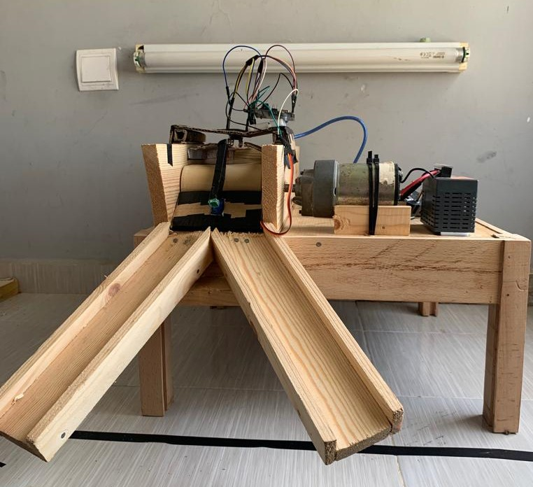
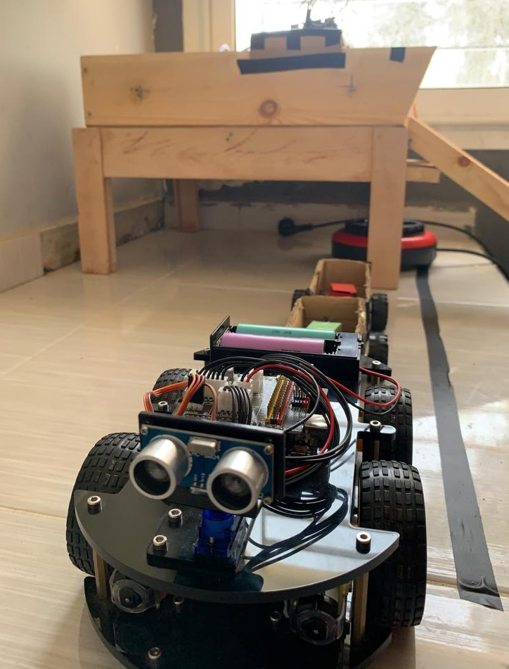
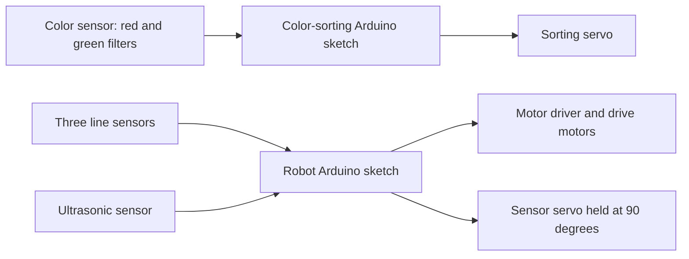

# Design and Development of an Intelligent Sorting and Inventory Management System

**Official French title:** Conception et Réalisation d’un Système Intelligent de Tri et de Gestion de Stock

An academic DUT final-year project exploring intelligent sorting and inventory management through Arduino-based robotics, color detection, servo control, and autonomous line following. The available Arduino code represents **two independent prototypes—a conveyor color sorter and a line-following mobile robot—not a fully integrated inventory management system**. This repository preserves their source code and five photographs of the physical prototypes.

The project was completed by **Noureddine Ogad in collaboration with Bilal Ezzouhri** during the **2022–2023 academic year**, as a **DUT final-year project in Embedded Systems** at **École Supérieure de Technologie de Fès (ESTF), Université Sidi Mohamed Ben Abdellah**. It is presented here as prior academic engineering work. The firmware is archival prototype code with known issues; compilation and hardware operation have not been revalidated during repository preparation.

## What the code implements

| Subsystem | Implemented behavior |
| --- | --- |
| Color sorter | Reads red- and green-filter pulse durations from a color sensor; applies fixed thresholds; directs a servo to 107° for red, 145° for green, or 170° otherwise. |
| Mobile robot | Reads three active-low line sensors; commands two motor channels forward, left, or right; stops when the sampled ultrasonic distance is at most 20 cm. |
| Diagnostics | Both sketches write sensor values or movement messages over serial at 9600 baud. |

The project demonstrates sensor interfacing, threshold-based decisions, PWM motor control, servo control, and integration with a physical conveyor and robot chassis. No measured throughput, classification accuracy, or reliability results are supplied.

“Stock management” in the original project title refers to the material-handling concept. The supplied code has **no inventory database, item counter, box-full detection, coordinated dispatch, wireless communication, or AI model**. The robot stops for obstacles; it does not plan a route around them. The conveyor motor is not controlled by either sketch.

## Prototype photographs

| Conveyor sorter | Mobile robot |
| --- | --- |
|  |  |

## Architecture



Each sketch has its own `setup()` and `loop()` and must be built separately. There is no communication between them in the supplied source. The conveyor and transport robot form a physical demonstration rather than an integrated software service.

## Technologies and hardware

- Arduino C/C++, the Arduino core API, and `Servo.h` (Arduino Servo library).
- Arduino IDE for building and uploading. The original hardware documentation identifies an UNO controller for the robot; confirm the actual board for each subsystem before selecting a build target.
- TCS230/TCS3200-style color sensor interface; the original documentation uses both model names, so verify the fitted module.
- Sorting servo; robot drive motors with an L298N driver, three line sensors, ultrasonic distance sensor, and sensor-positioning servo.
- A separately powered conveyor assembly; the original design describes a 24 V conveyor motor.

No dependency versions or reproducible board profile were recorded. There are no custom library files or local headers referenced by the sketches; the only explicit library include is `Servo.h`.

## Project structure

The original French directory names are preserved.

```text
.
├── README.md
├── .gitignore
├── source coudes/
│   ├── triage par couleur/
│   │   └── triage par couleur.ino       # Color-sorting controller
│   └── gestion de stock par Robot/
│       └── gestion de stock par Robot.ino  # Line-following robot controller
└── realisation/
    ├── covy.jpeg, covy2.jpeg            # Conveyor photographs
    └── clark1.jpeg, clack2.jpeg, clack3.jpeg  # Robot photographs
```

The local archive also contains reports, slides, presentation notes, reference illustrations, historical code screenshots, and a video. These are intentionally excluded from the proposed public repository pending review. They are not runtime dependencies. There are no editable CAD/electrical design files, automated tests, or CI configuration in the supplied archive.

## Pin assignments

These tables describe the `.ino` files, not the historical screenshots. They are signal mappings, not complete power-wiring instructions.

| Color sorter signal | Arduino pin |
| --- | --- |
| S0 / S1 | 2 / 3 |
| S2 / S3 | 4 / 5 |
| Sensor OUT | 6 |
| Sorting servo | 8 |

| Robot signal | Arduino pin |
| --- | --- |
| Right / middle / left line sensor | 10 / 4 / 2 |
| Motor ENA / ENB | 5 / 6 |
| Motor IN1 / IN2 / IN3 / IN4 | 7 / 8 / 9 / 11 |
| Ultrasonic echo / trigger | A4 / A5 |
| Sensor servo | 3 |

## Installation and execution

1. Install the Arduino IDE, the board package appropriate for your hardware, and the Arduino Servo library if it is unavailable. For a confirmed classic UNO, use the Arduino AVR Boards package and Arduino Uno target. Original tool/library versions are unknown.
2. Prepare working copies using valid sketch names. The archived names contain spaces, which do not meet the [Arduino sketch naming specification](https://docs.arduino.cc/arduino-cli/sketch-specification/). Run the following PowerShell commands from this project folder once; they leave the originals untouched and refuse to overwrite existing working files:

   ```powershell
   New-Item -ItemType Directory -Path '.arduino-work/color_sorter', '.arduino-work/line_following_robot' -Force | Out-Null
   if ((Test-Path '.arduino-work/color_sorter/color_sorter.ino') -or (Test-Path '.arduino-work/line_following_robot/line_following_robot.ino')) {
       throw 'Working sketches already exist. Review them before making new copies.'
   }
   Copy-Item -LiteralPath 'source coudes/triage par couleur/triage par couleur.ino' -Destination '.arduino-work/color_sorter/color_sorter.ino'
   Copy-Item -LiteralPath 'source coudes/gestion de stock par Robot/gestion de stock par Robot.ino' -Destination '.arduino-work/line_following_robot/line_following_robot.ino'
   ```

   On other operating systems, copy each original into its own matching folder/file pair as shown above. The working-copy directory is ignored by Git; reviewed permanent fixes should ultimately be applied to the maintained source.
3. Open one working `.ino` file in Arduino IDE, select the confirmed board, and run **Verify**. Review compiler warnings as well as errors. Do not combine the two sketches into one folder.
4. Before powered operation, address the robot pin-initialization and blocking-loop issues below. Confirm signal connections, motor supply requirements, and shared signal ground against the actual modules. Never connect the conveyor's 24 V supply to Arduino signal pins.
5. Connect the relevant controller by USB, select its port, and upload the corresponding verified sketch. Repeat separately for the other controller if using both subsystems.
6. Open Serial Monitor at **9600 baud**. For the sorter, observe `R=` and `G=` readings and calibrate thresholds/servo positions for the actual lighting and mechanism. For the robot, start with drive wheels raised, verify sensor polarity and motor direction, then test on a controlled line track.

These are setup instructions, not a record of a successful build or hardware test.

## Known issues and limitations

- **Robot input initialization:** `LT_R`, `LT_M`, and `LT_L` expand to inverted `digitalRead(...)` expressions. Passing them to `pinMode()` configures pin 0 or 1 instead of pins 10, 4, and 2. This can also interfere with serial pins. Separate sensor pin numbers from sensor-read expressions before operating the robot.
- **Blocking turns:** `while(LT_R);` and `while(LT_L);` can keep the robot turning indefinitely. Obstacle distance is not refreshed during these loops.
- **Lost-line behavior:** when no line sensor is active and the distance check passes, no new motor command is issued; the previous command remains in effect.
- **Sensor timing:** both sketches use blocking delays and `pulseIn()` without an explicit timeout. `pulseIn()` returns pulse duration, not frequency, despite the sorter's variable name; a timeout returns zero. See the [Arduino reference](https://docs.arduino.cc/language-reference/en/functions/advanced-io/pulseIn/). The robot treats that zero as a stop condition but does not distinguish it from a near obstacle.
- **Color calibration:** only red and green readings are used. Red requires `50 < R < 80` and `102 < G < 250`; green requires `110 < R < 130` and `140 < G < 164`. All other readings use the default servo position. There is no separate item-presence test or explicit sensor-failure state.
- **Unused helpers:** the sorter's `readColor()` and `GreenColor()` declare `int` return types but return no value. They are not called by the current loop and may produce compiler warnings. The `color` variable and robot `back()` function are also unused.
- Historical code screenshots contain different sorter thresholds/servo settings. Treat the editable `.ino` files as authoritative.
- No full wiring package, version-pinned environment, calibration dataset, benchmark, automated test suite, or hardware validation log is provided.

The original firmware has been left unchanged to preserve the submitted project. This repository documents its current state rather than claiming production readiness.

## Validation status

Repository preparation included reading both sketches, checking the source dependencies and paths, reviewing the archive inventory and publication risks, and verifying preservation of original files. No hardcoded machine paths or credentials were found in the two sketches. Arduino CLI/compiler tools were unavailable in the preparation environment, so **compilation, upload, and hardware behavior remain unverified**.

## Attribution

This is a joint academic project by Noureddine Ogad and Bilal Ezzouhri. Individual contribution boundaries are not recorded in the supplied files. No software license was present in the original archive; no new license has been assigned during preparation.
